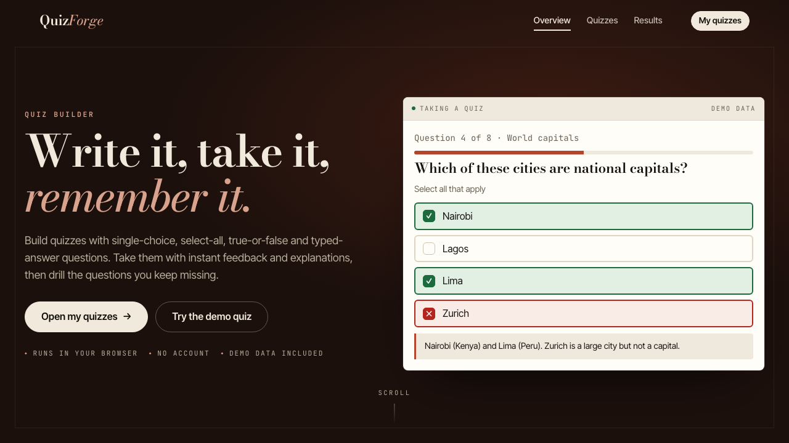
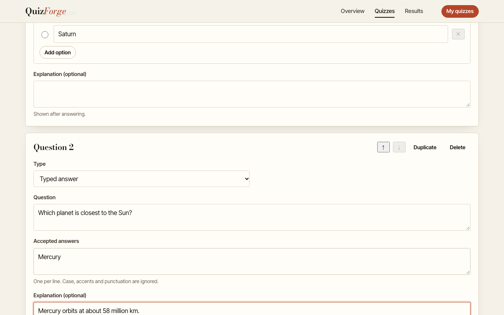
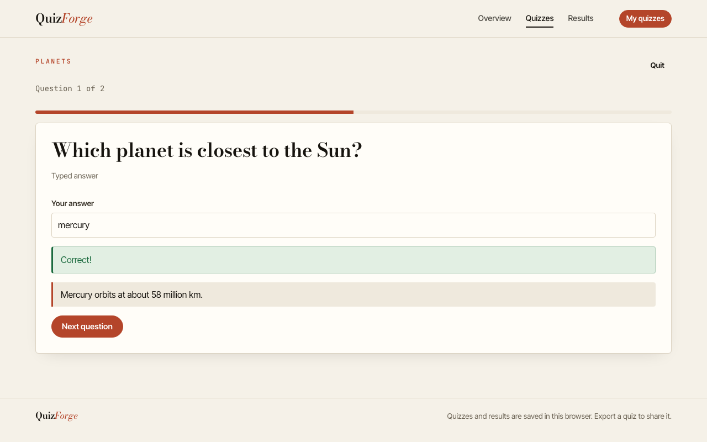
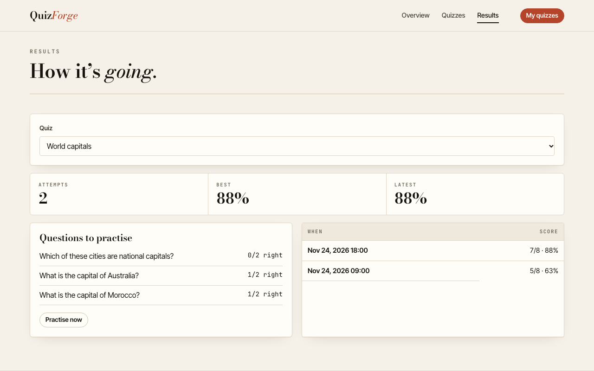

# QuizForge

Write quizzes and take them. Four question types, instant feedback with explanations, forgiving typed answers, a retry-the-missed round, per-question results and JSON import/export.

**Live demo:** [https://quizforge-studio.vercel.app/](https://quizforge-studio.vercel.app/) — runs entirely in your browser.



| Editor | Playing | Results |
| --- | --- | --- |
|  |  |  |

## Run it

```bash
npm install
npm run dev        # http://localhost:5302
npm test
npm run build
npm run test:e2e   # Playwright smoke test (npm run e2e:install once if Chromium is missing)
```

## Main workflow

1. **Quizzes** → create a quiz, or import a QuizForge JSON file (validated before it’s added).
2. **Edit** → add single-choice, select-all, true/false or typed-answer questions; mark correct options, list accepted typed answers, add explanations; reorder, duplicate or delete. Problems are listed under each question and Play stays disabled until they’re fixed. Changes save as you type.
3. **Play** → one question at a time (questions and options shuffled if enabled). Number keys pick options; Enter checks and moves on. Feedback shows the correct answer and the explanation.
4. The summary lists every answer; **Retry the missed** runs just those (practice rounds aren’t saved).
5. **Results** → attempts, best and latest scores, and the questions you miss most.
6. Quizzes and results persist in this browser; demo quizzes (with sample history) can be cleared.

## Rules

- Single choice and true/false need exactly one correct option; select-all needs at least one; options must be non-empty and distinct.
- Select-all is right only when every correct option and nothing else is picked; a partly right pick says how many you found.
- Typed answers ignore case, accents and punctuation; with “allow one typo” on, answers of five or more letters accept one edit.
- Exports use `format: "quizforge/1"` without internal ids; imports get fresh ids.

## Design

Shared editorial system: Bodoni Moda display type for prompts, Inter Tight interface text, a brick-red accent, an ink hero showing a marked question, and a warm paper workspace. Right and wrong options are marked with colour plus a tick or cross.

## Tests

- `src/lib/quiz.test.ts` — validation for every type, exact and partial select-all grading, typed-answer normalisation and typo tolerance, deterministic shuffling, scoring, per-question stats and weakest questions, import/export round trip and import errors.
- `src/App.test.tsx` — a full play-through with partial feedback, keyboard selection and typed answers, the summary and retry-missed; editor validation blocking play; import success and failure; results and weak questions.
- `e2e/smoke.spec.ts` — landing, building a two-question quiz with reload persistence, playing it with the keyboard, results, plus 375px layout checks.

## Limitations

- No images in questions, timers or spaced repetition.
- Results stay on this device.

## Future improvements

- Image and code-block questions; a timed mode.

## Licence

MIT — see [LICENSE](LICENSE).
